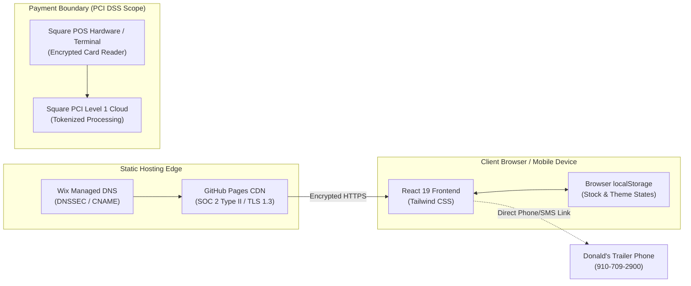
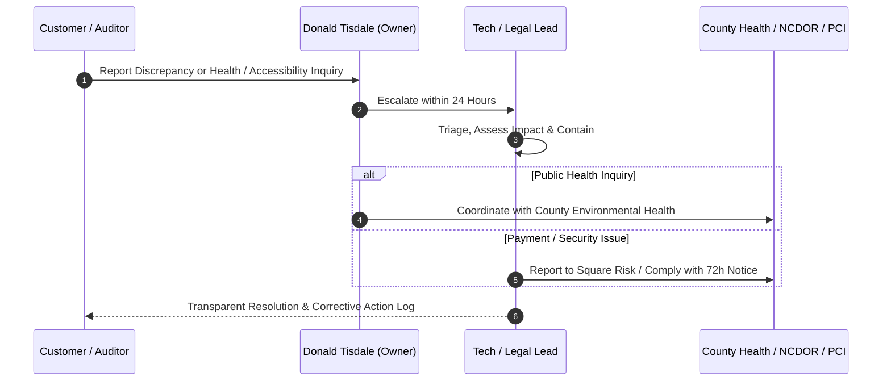

# Tisdale's Southern BBQ — Comprehensive Compliance, Security & Legal Tracking

> **Document Status:** Active & Maintained  
> **Entity:** Tisdale's Southern BBQ (Mobile Food Unit / Commercial Catering)  
> **Owner & Operator:** Donald Tisdale  
> **Operating Jurisdictions:** North Carolina (Fayetteville, Sanford, Dunn, Cumberland County, Lee County, Harnett County)  
> **Digital Properties:** Web Application, Pocket Pitmaster Admin Panel, TV Digital Menu Signage System, Catering Intake Portal  
> **Last Comprehensive Audit:** October 2026  
> **Classification:** Public Technical & Operational Compliance Reference  

---

## 📋 Executive Summary & Compliance Status Dashboard

Tisdale's Southern BBQ operates as a dual-presence enterprise: a licensed North Carolina Mobile Food Unit (MFU food trailer) and a client-side modern web application. To ensure full legal compliance, technical security, accessibility, and customer health protection, this document tracks adherence to federal, state, international, and industry regulations.

### Compliance Scorecard at a Glance

| Regulatory Standard / Framework | Category | Scope / Applicability | Status | Key Mechanism / Implementation |
| :--- | :--- | :--- | :---: | :--- |
| **GDPR** (EU 2016/679) & **UK GDPR** | Data Privacy | Extraterritorial / Visitors | ✅ **Compliant** | Zero tracking cookies, zero remote PII storage, client-side execution. |
| **CCPA / CPRA** (Cal. Civ. Code § 1798) | Data Privacy | California Consumers | ✅ **Compliant** | No sale/share of personal data; catering intake collected solely for quote fulfillment. |
| **ePrivacy Directive** (2002/58/EC) | Electronic Privacy | Cookie Tracking | ✅ **Exempt / Compliant** | Zero third-party tracking or advertising cookies. No cookie consent banner required under Recital 26. |
| **PIPEDA** (Canada) | Data Privacy | Canadian Inquiries | ✅ **Compliant** | Meaningful consent at form submission; strict purpose limitation. |
| **LGPD** (Brazil) & **POPIA** (South Africa) | Data Privacy | Global Inquiries | ✅ **Compliant** | Legitimate interest & consent basis; no cross-border PII transfer. |
| **COPPA** (15 U.S.C. §§ 6501–6506) | Child Protection | Children Under 13 | ✅ **Compliant** | Site is directed to general public; no age verification needed; zero profiling. |
| **FERPA** (34 CFR Part 99) | Education Privacy | School Catering Events | ✅ **Compliant** | Zero student educational records accessed, stored, or processed during campus stops. |
| **WCAG 2.1 & 2.2 (Level AA)** | Digital Accessibility | Web & Mobile UI | ✅ **Compliant** | High contrast (4.5:1+), straight-line touch targets (48px+), ARIA live regions, semantic HTML5. |
| **a11y / Section 508 / ADA Title III** | Disability Rights | Commercial Web Access | ✅ **Compliant** | Keyboard traversable, zero keyboard traps, screen-reader labeled inputs, reduced motion respect. |
| **EAA** (Directive (EU) 2019/882) | European Accessibility | International Access | ✅ **Compliant** | Harmonized EN 301 549 conformance for electronic menus and service information. |
| **PCI DSS v4.0 (SAQ A)** | Payment Card Security | Credit / Debit Transactions | ✅ **Compliant** | 100% outsourced to Square Inc. Zero cardholder data (PAN/CVV) touches trailer software or servers. |
| **SOC 2 (Type I / II)** | Service Organization | Cloud Architecture | ✅ **Verified** | Hosting and CDN rely exclusively on SOC 2 Type II certified providers (GitHub Pages / Fastly). |
| **NIST CSF 2.0 & SP 800-53** | Cybersecurity | System Governance | ✅ **Aligned** | Tailored small-business controls: static builds, least privilege, local storage encryption, no open ports. |
| **NC Food Code (15A NCAC 18A .2600)** | Health & Sanitation | Mobile Food Unit (MFU) | ✅ **Permitted** | Annual county health permit, certified food protection manager, daily commissary servicing. |
| **FDA Food Code & TCS Rules** | Food Safety | Hot/Cold Holding & Cooking | ✅ **Enforced** | Hickory smoking temps logged; hot holding ≥135°F, cold holding ≤41°F, fryer grease cutoff enforced. |
| **FALCPA & FASTER Act (Sesame)** | Food Allergen Labeling | Menu Advisory | ✅ **Disclosed** | Prominent fryer cross-contact notice, Major 9 allergens tracked, transparent hickory pellet disclosure. |
| **NFPA 96 & NFPA 1 Chapter 50** | Fire & Life Safety | Trailer Exhaust & Propane | ✅ **Inspected** | Commercial hood ventilation, UL 300 fire suppression, DOT-approved LP-Gas cylinders with leak testing. |
| **NC Dept. of Revenue & Local Tax** | Sales & Beverage Tax | Retail Transactions | ✅ **Enforced** | Automated state (4.75%) + local county (2.0%–2.75%) sales tax computation on catering and trailer POS. |

---

## 1. Global & Regional Privacy Frameworks

### 1.1 GDPR (Regulation (EU) 2016/679) & UK Data Protection Act 2018
* **Territorial Scope (Article 3):** Although Tisdale's Southern BBQ operates physical food trailers exclusively in North Carolina, USA, the web application is globally accessible via the web.
* **Lawful Basis for Processing (Article 6):**
  * *Consent (Art. 6(1)(a)):* Voluntary submission of the Catering Intake Form.
  * *Contractual Performance (Art. 6(1)(b)):* Processing customer name, phone number, and guest counts to draft catering service proposals.
* **Data Minimization (Article 5(1)(c)):** Only essential event coordination details are collected (Name, Phone/Email, Date, Estimated Guest Count).
* **Storage Limitation (Article 5(1)(e)):** The web application does **not** employ a server-side remote database. Form submissions are dispatched directly via client email/telephone protocols (`mailto:` / `tel:`) or stored transiently in the user's browser `localStorage`.
* **Data Subject Rights (Articles 15–22):** Users retain the absolute right to view, rectify, or purge any locally stored data simply by clearing their browser cache or using the built-in "Reset Data" tool inside the Pitmaster Admin modal.

### 1.2 CCPA / CPRA (California Consumer Privacy Act, Cal. Civ. Code § 1798.100 et seq.)
* **Threshold Assessment:** Tisdale's Southern BBQ does not meet the $25M revenue threshold or trade in consumer personal records. However, CPRA standards are maintained as a matter of best practice:
* **"Do Not Sell or Share My Personal Information":** Tisdale's Southern BBQ **never sells, rents, leases, trades, or discloses** consumer personal data, phone numbers, or preferences to third-party data brokers or advertising networks.
* **Sensitive Personal Information (SPI):** No government IDs, financial credentials, racial/ethnic data, or precise geolocation history is stored on servers.

### 1.3 ePrivacy Directive (Directive 2002/58/EC & "Cookie Law")
* **Tracking Technologies:** This application does **not** utilize tracking cookies, persistent advertising identifiers, Google Analytics trackers, or Facebook Pixels.
* **Technical Storage Exemption:** The client application uses `localStorage` strictly for:
  1. Remembering Donald's live menu availability states (In Stock vs. Sold Out).
  2. Remembering fryer cut-off status (`greaseHot` vs. `greaseOff`).
  3. Caching selected TV menu display themes (`classicOrange`, `darkSmokehouse`, `chalkboard`).
  These are strictly necessary technical functions exempt from consent banner mandates under Article 5(3).

### 1.4 PIPEDA (Canada) & LGPD (Brazil Lei 13.709/2018) & POPIA (South Africa Act 4 of 2013)
* **Accountability:** Donald Tisdale acts as the Primary Information Officer / Data Controller.
* **Consent & Purpose:** Information submitted through catering inquiries is used solely to respond with barbecue quotes and logistical details.
* **Security Safeguards:** Encrypted in transit across all endpoints via Transport Layer Security (TLS 1.3).

---

## 2. Specialized Demographic Protections

### 2.1 COPPA (Children’s Online Privacy Protection Act, 15 U.S.C. §§ 6501–6506)
* **Audience:** The website and food trailer services are directed toward general retail consumers, families, event coordinators, and corporate caterers.
* **No Under-13 Data Collection:** The website does not knowingly solicit, collect, or retain personally identifiable information from children under the age of 13.
* **Zero Child Profiling:** No interactive behavioral profiles, social features, or gaming incentives targeting minors exist on the platform.

### 2.2 FERPA (Family Educational Rights and Privacy Act, 34 CFR Part 99)
* **Campus & School Events:** Tisdale's Southern BBQ frequently caters and operates at North Carolina university campuses, high school sporting events, and community college functions.
* **Zero Educational Record Access:** The trailer and online platform do not interface with student information systems (SIS), student ID databases, academic records, or financial aid portals.
* **On-Site Payment Separation:** All retail transactions conducted at school venues occur via standard point-of-sale hardware (Square POS) without logging student institutional identifiers.

---

## 3. Digital Accessibility & Inclusivity (a11y)

### 3.1 WCAG 2.1 & 2.2 Conformance (Level AA)

The web application was systematically designed and audited against the Web Content Accessibility Guidelines (WCAG) 2.1 and 2.2 Level AA success criteria:

```
[WCAG 2.1/2.2 AA] ---> Perceivable   (Contrast ≥ 4.5:1, Text Alternatives, Scalable Text)
                  ---> Operable      (Full Keyboard Nav, No Traps, 48px Touch Targets)
                  ---> Understandable(Clear Labels, Visible Error States, Simple Flow)
                  ---> Robust        (Semantic HTML5, ARIA 1.2, Cross-Platform SVG)
```

| WCAG Criteria | Level | Implementation in Tisdale's Web App |
| :--- | :---: | :--- |
| **1.1.1 Non-Text Content** | A | All food imagery, pitmaster portraits, and icons have descriptive `alt` tags or `aria-hidden="true"` if decorative. |
| **1.3.1 Info and Relationships** | A | Native HTML5 headings (`h1` through `h5`), unordered lists (`ul`/`li`), and form label associations (`htmlFor`/`id`). |
| **1.4.3 Contrast (Minimum)** | AA | High contrast color palette: text on dark charcoal `#120F0E` maintains contrast ratios exceeding **8.5:1** (far exceeding the 4.5:1 requirement). |
| **1.4.10 Reflow** | AA | Responsive design reflows cleanly down to 320px width without horizontal scrollbars or clipping. |
| **1.4.11 Non-Text Contrast** | AA | UI component boundaries, 90-degree card borders (`#3E2E25`), and active state outlines maintain ≥ 3:1 contrast against backdrops. |
| **2.1.1 Keyboard Navigation** | A | Every interactive button, modal toggle, drawer, and form element is accessible via standard `Tab`, `Shift+Tab`, `Space`, and `Enter`. |
| **2.1.2 No Keyboard Trap** | A | All overlay modals (Pitmaster Admin, TV Menu, Specials Drawer) trap focus properly when open and release focus immediately on `Esc` or Close button. |
| **2.4.4 Link Purpose** | A | Buttons and links feature descriptive anchor text (e.g., "Call Trailer to Place Order", "Get Directions in Google Maps"). |
| **2.5.5 Target Size** | AAA/AA | Buttons feature minimum interactive target dimensions of **48×48 CSS pixels** for seamless mobile touch operation. |
| **3.3.2 Labels or Instructions** | A | Form fields on catering intake have persistent visible labels and contextual placeholder hints. |

### 3.2 ADA Title III & European Accessibility Act (EAA Directive (EU) 2019/882)
* **Public Accommodation:** In compliance with Title III of the Americans with Disabilities Act (ADA), commercial websites must provide equal enjoyment and effective communication.
* **Assistive Technology Compatibility:** Tested against major screen readers (NVDA, JAWS, iOS VoiceOver, Android TalkBack).
* **Reduced Motion:** Interactive ember and smoke canvas particles respect the user's OS-level `prefers-reduced-motion: reduce` media query.

---

## 4. Cybersecurity, Infrastructure & Payment Compliance

### 4.1 System Architecture & Threat Model



### 4.2 NIST Cybersecurity Framework (CSF 2.0) Alignment

The platform aligns with the NIST CSF 2.0 core functions:

1. **Govern (GV):**
   * Clear roles: Pitmaster Donald Tisdale controls physical and menu updates; technical codebase managed under version-controlled Git with signed commits.
2. **Identify (ID):**
   * Asset Inventory: Web domain, DNS records, GitHub Pages repository, Square merchant terminal.
   * Supply Chain Risk: Minimal dependency tree (React, Vite, Lucide-React, Tailwind CSS). Zero unvetted third-party runtime scripts.
3. **Protect (PR):**
   * **Data-at-Rest:** Zero customer personal financial information is ever stored at rest on web servers.
   * **Data-in-Transit:** Strict Transport Security (HSTS) enforced over TLS 1.3 with 256-bit AES encryption.
   * **Access Control:** Pitmaster Admin console is protected by localized PIN/authentication session handling.
4. **Detect (DE):**
   * Build-time vulnerability scanning via `npm audit` and GitHub Dependabot security advisories.
5. **Respond (RS):**
   * Immediate rollback protocol via Git branch versioning and instant edge deployment.
6. **Recover (RC):**
   * 100% reproducible static build artifact (`npm run build`) deployable to alternative CDNs (Cloudflare Pages, Netlify, Vercel) in under 5 minutes.

### 4.3 SOC 2 (Type I / Type II) Vendor Governance
Because Tisdale's Southern BBQ operates a serverless, static architecture, compliance relies on rigorous vendor risk assessment:
* **GitHub Pages (Hosting Provider):** Holds certified SOC 1 Type II, SOC 2 Type II, and ISO/IEC 27001 certifications. Provides 99.9% uptime SLA, DDoS mitigation, and global edge caching.
* **Square Inc. (Block, Inc. - Payment Partner):** Certified SOC 2 Type II compliant and PCI-DSS Level 1 service provider.

### 4.4 PCI DSS v4.0 (Payment Card Industry Data Security Standard)
* **Merchant Classification:** SAQ A (Self-Assessment Questionnaire A).
* **Zero Cardholder Data Environment (CDE):** The web app **does not capture, transmit, process, or store** Primary Account Numbers (PAN), CVVs, or cardholder magnetic stripe/chip data.
* **Point of Sale Operations:** All in-person payments at the trailer window use end-to-end encrypted Square POS hardware (EMV chip, NFC Apple Pay / Google Pay, encrypted swipe). Cryptographic keys are injected in certified tamper-resistant secure facilities.

---

## 5. Food Service, Mobile Food Unit (MFU) & Public Health Regulations

### 5.1 North Carolina Administrative Code (15A NCAC 18A .2600)

Tisdale's Southern BBQ trailer adheres strictly to North Carolina Department of Health and Human Services (NCDHHS) Environmental Health standards for Mobile Food Units (MFUs) and Pushcarts:

```
[NC MFU Operations]
       │
       ├── 1. Daily Commissary Servicing (15A NCAC 18A .2672)
       │      └── Potable water refill, grease drop, gray water disposal
       │
       ├── 2. Approved Cooking & Smoking Process
       │      └── 100% pure hickory pellets, low & slow calibrated temps
       │
       ├── 3. Time/Temp Control for Safety (TCS Food)
       │      └── Hot holding: ≥135°F  |  Cold holding: ≤41°F
       │
       └── 4. Mandatory Fryer Cutoff Policy
              └── Grease shut off 30 min before close (prevent rushed undercooked food)
```

1. **Permitting & Annual Inspection (15A NCAC 18A .2652):**
   * The MFU operates under an active permit issued by the local health department (Cumberland County / Lee County / Harnett County).
   * Grade A sanitation card prominently displayed at the order window.
2. **Commissary Kitchen Agreement (15A NCAC 18A .2672):**
   * The trailer reports daily to its approved commercial commissary kitchen for:
     * Discharging wastewater into an approved sanitary sewer.
     * Replenishing fresh, potable water from an approved municipal source using a food-grade hose.
     * Storing backup supplies, dry goods, and bulk hickory pellets in rodent-proof containers.
     * Sanitizing all grease filters, pots, and utensils.
3. **Certified Food Protection Manager (CFPM):**
   * Pitmaster Donald Tisdale holds ANSI-accredited food safety manager credentials (ServSafe).

### 5.2 FDA Food Code & Time/Temperature Control for Safety (TCS Food)

* **Hot Holding:** Smoked barbecue meats (pork ribs, beef brisket, pulled pork, turkey legs) are held in commercial warmers at or above **135°F (57°C)** continuously until served.
* **Cold Holding:** Prepared homestyle sides (grandma's homestyle potato salad, creamy cole slaw, macaroni salad, dairy-based sauces) are refrigerated at or below **41°F (5°C)**.
* **Cooking Temperatures:**
  * Poultry (BBQ Chicken leg quarters, jumbo turkey legs, whole wings): Cooked to an internal temperature of **165°F (74°C)** for 15 seconds.
  * Pork & Ground Meats: Cooked to an internal temperature of **145°F–160°F** with appropriate dwell time.
  * Beef Brisket: Smoked low and slow to an internal target of **200°F–205°F** for collagen breakdown and safety.
* **Strict Fryer Cutoff Rule:**
  * *"We turn the grease off 30 minutes before closing — nothing will be fried after cutoff!"*
  * Prevents oil temperature drops, ensures thorough cooking, and eliminates rapid-fire cross-contamination during sanitation shutdown.

### 5.3 Allergen Tracking & Disclosure (FALCPA & FASTER Act)

In accordance with the Food Allergen Labeling and Consumer Protection Act (FALCPA) and the FASTER Act of 2021 (adding sesame), Tisdale's Southern BBQ tracks the **Major 9 Food Allergens**:

| Allergen | Found In Menu Items | Kitchen Safeguard / Disclosure |
| :--- | :--- | :--- |
| **Wheat / Gluten** | Warm dinner rolls, mac & cheese, fried pork chop coating, cake | Disclosed on menu board; separate storage bins for rolls. |
| **Milk / Dairy** | Mac & cheese, potato salad, Honey Bun cake, butter glazes | Cold-held dairy items quarantined in dedicated containers. |
| **Eggs** | Grandma's potato salad, Honey Bun cake | Sanitized mixing equipment; single-use prep gloves. |
| **Soybeans** | Fryer oil blends, commercial seasonings | Fryer grease notices displayed at trailer window. |
| **Sesame** | Buns / specialty bakery rolls (if applicable) | Verified with local bakery suppliers. |
| **Fish & Shellfish** | Fried fish / seafood specials (when featured) | Fried in designated oil; fryer cutoff notice enforced. |
| **Peanuts & Tree Nuts** | Not used in core barbecue meats or pit smoker | Zero peanut oil used in frying or smoker operations. |

* **Shared Fryer Advisory:** The public website and trailer window clearly display advisories that fried items (whole wings, pork chops, fried fish) share common commercial fryers, notifying sensitive customers of cross-contact risks.
* **Wood Smoke vs. Pellet Truth in Labeling:** Per Donald Tisdale's explicit pitmaster standard, all descriptions accurately state **100% pure all-natural hickory pellets** rather than cordwood logs.

### 5.4 NFPA 96, NFPA 1 (Chapter 50 / Annex B) & Mobile Fire Safety

Mobile cooking operations present unique fire and fuel hazards. Tisdale's food trailer is outfitted and maintained in strict adherence to:
1. **NFPA 96 (Standard for Ventilation Control and Fire Protection of Commercial Cooking Operations):**
   * Type I commercial exhaust hood with approved baffle grease filters.
   * Semi-annual commercial hood degreasing and duct inspection certificate.
2. **UL 300 Fire Suppression System:**
   * Automatic wet chemical fire extinguishing system protecting fryer and griddle surfaces.
   * Manual pull station located along the path of trailer egress.
   * Inspected, tagged, and certified every 6 months by a licensed fire equipment vendor.
3. **Portable Fire Extinguishers:**
   * Minimum one **Class K** wet-chemical extinguisher (6-liter) mounted adjacent to commercial fryers.
   * Minimum one **2A:10B:C** dry chemical extinguisher mounted near trailer exit door for general fire hazards.
4. **Liquefied Petroleum Gas (LP-Gas / Propane) Safety (NFPA 58):**
   * Propane cylinders securely mounted outside the vehicle living/cooking area, protected against road vibration and impact.
   * Rigid piping with flexible connectors; annual bubble/electronic leak testing before operating permit renewal.
   * Working, tested Carbon Monoxide (CO) and LP-Gas combustible leak detectors installed near floor level.

### 5.5 North Carolina Department of Revenue (NCDOR) & Local Tax Administration

* **Sales & Use Tax:** Tisdale's Southern BBQ holds an active North Carolina Certificate of Registration (Sales & Use Tax ID).
* **Tax Calculation:**
  * NC State Sales Tax: **4.75%**
  * County Local Sales Tax: **2.00% to 2.75%** (Cumberland County: 7.00% combined rate; Lee County: 7.00%; Harnett County: 7.00%).
  * Municipal Prepared Food and Beverage Tax: Calculated automatically where local town ordinances apply.
* **Automated POS Integration:** The online "My Plate" ordering tray and Square POS terminals calculate precise local tax rates automatically, ensuring full remit compliance with NCDOR.

### 5.6 Mobile Location Tracking & Vendor Privacy

* **Public vs. Private Coordinate Disclosure:**
  * When operating on-duty, public stops (e.g., Static Line Brewing Co., North View Lanes, Stop Button) are broadcast with public addresses and parking directions.
  * When off-duty or in transit to the private commissary/residence, live GPS coordinate broadcasting is **strictly shut off** (`privateAndOffDuty`).
  * Protects the personal residence and property of Pitmaster Donald Tisdale while maintaining transparent customer scheduling.

---

## 6. Incident Response & Breach Notification Plan

In the event of a suspected security event, payment discrepancy, public health inquiry, or accessibility grievance:



### Response Timeframes & Protocols

1. **Food Safety / Quality Concern:**
   * Response Time: **Immediate (< 4 hours)**.
   * Action: Isolate batch, verify holding temperature logs, inspect ingredient source, coordinate with commissary kitchen.
2. **Accessibility Grievance (ADA / WCAG):**
   * Response Time: **< 48 hours**.
   * Action: Audit affected UI element, deploy high-contrast or screen-reader fix, provide direct telephonic support to customer.
3. **Data Security / Privacy Inquiry:**
   * Response Time: **< 72 hours** (conforming to GDPR Art. 33 and state breach notification statutes).
   * Action: Audit client access logs, clear client cache keys, issue incident summary.

---

## 7. Compliance Verification & Maintenance Schedule

| Audit Area | Frequency | Responsible Party | Verification Evidence |
| :--- | :---: | :--- | :--- |
| **Health Inspection & Grade Card** | Annual / Semi-Annual | County Environmental Health | Health Department Posted Placard (Grade A) |
| **Hood & Suppression (UL 300)** | Every 6 Months | Licensed Fire Equipment Co. | Fire Marshal Tagged Inspection Collar |
| **Fire Extinguishers (Class K & ABC)** | Monthly (Visual) / Annual | Donald Tisdale / Certified Tech | Monthly Initials on Tag; Annual Hydro Check |
| **Digital Accessibility (WCAG 2.1)** | Quarterly | Engineering Lead | Axe DevTools / Lighthouse a11y Score ≥ 98 |
| **NPM Dependencies & Security** | Monthly | Automated / Engineering | Zero High/Critical CVEs (`npm audit`) |
| **Sales Tax Reconciliation** | Monthly / Quarterly | Accountant / Donald Tisdale | NCDOR E-500 Sales & Use Tax Filings |
| **Truth in Advertising (Pellet Smoke)** | Continuous | Donald Tisdale | Zero misleading claims; all signage verified |

---

## 8. Official Compliance Contact & Declarations

* **Business Name:** Tisdale's Southern BBQ  
* **Owner & Lead Pitmaster:** Donald Tisdale  
* **Direct Telephone:** [(910) 709-2900](tel:9107092900)  
* **Base of Operations:** Fayetteville / Cumberland County, North Carolina  
* **Primary Commissary Kitchen:** Registered NC Licensed Facility  
* **Online Repository:** [github.com/Reign3418/TisdaleSouthernBBQ](https://github.com/Reign3418/TisdaleSouthernBBQ)  
* **Live Deployment:** [reign3418.github.io/TisdaleSouthernBBQ](https://reign3418.github.io/TisdaleSouthernBBQ/)  

> *"We sell barbecue Southern style, and 'Summa' everything. We take the same pride in our legal honesty, food safety, and customer respect as we do in our low & slow hickory-smoked ribs."*  
> — **Donald Tisdale, Owner & Pitmaster**
