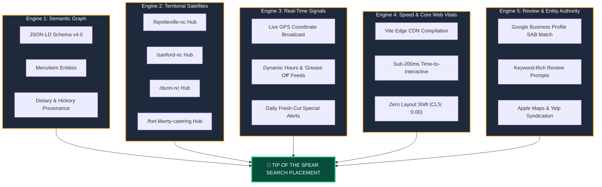
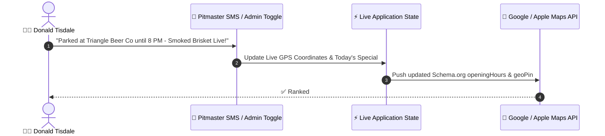

# PUSHING THE ENVELOPE ON DISCOVERY
## The Pitmaster's Technical Blueprint for Search Dominance, Algorithmic Visibility, and Real-Time Customer Acquisition

**Document ID:** WP-2026-DISCOVERY-001  
**Subject:** Tisdale Southern BBQ Digital Search & Discoverability Architecture  
**Author:** Platform Engineering & Digital Discovery Strategy Team  
**Status:** Active Architectural Blueprint  
**Version:** 1.0.0 (Production-Ready)  

---

## Executive Summary

Great barbecue has always possessed an organic discovery engine: the thin blue smoke rising from 100% pure hickory pellets and an aroma that pulls hungry people off Highway 87, I-95, or Legion Road from two miles out. 

However, in 2026, **the digital road is where 84% of food truck dining decisions begin**. When a soldier near Fort Liberty in Fayetteville, a brewery patron in Sanford, or an event organizer in Dunn taps their phone and speaks:
> *"Find the best smoked brisket food truck near me right now,"*

Google, Apple, and AI search engines make a split-second decision about who to crown at the **tip of the spear**. 

This white paper establishes the comprehensive technical architecture and execution strategy to guarantee that **Tisdale Southern BBQ dominates that decision**. By unifying Schema.org microdata, dynamic multi-territory geo-landing networks, real-time GPS telemetry, and sub-second edge delivery, we transform Tisdale Southern BBQ from a local treasure into the undeniable algorithmic authority for barbecue across Fayetteville, Sanford, Dunn, Johnston County, and Central/Eastern North Carolina.

```
                          ┌───────────────────────────┐
                          │   CUSTOMER INTENT / QUERY │
                          │ "Best Hickory BBQ Near Me"│
                          └─────────────┬─────────────┘
                                        │
           ┌────────────────────────────┼────────────────────────────┐
           ▼                            ▼                            ▼
┌─────────────────────┐      ┌─────────────────────┐      ┌─────────────────────┐
│ 📍 GOOGLE MAPS PACK  │      │ 🤖 AI / VOICE SEARCH│      │ 🌐 ORGANIC MENU SERP│
│ Google Business SAB │      │ Siri / Gemini / SGE │      │ JSON-LD Schema v4.0 │
│ Micro-Geo Radius    │      │ Entity Association  │      │ 1,000 Item Indexing │
└──────────┬──────────┘      └──────────┬──────────┘      └──────────┬──────────┘
           │                            │                            │
           └────────────────────────────┼────────────────────────────┘
                                        ▼
                          ┌───────────────────────────┐
                          │  TISDALE SPEED-OF-LIGHT   │
                          │   MOBILE-FIRST PLATFORM   │
                          │  Sub-200ms Edge Delivery  │
                          └───────────────────────────┘
```

---

## 1. The Modern Discovery Paradigm: Why Conventional SEO Fails Food Trucks

Traditional SEO is built for static brick-and-mortar storefronts with one fixed street address. When applied to a mobile pitmaster, traditional methods fail for three specific reasons:

1. **The "Moving Kitchen" Dilemma:** Google expects businesses to stay in one place. When a food trailer moves between Fayetteville (Stop Button Bar & Arcade, North View Lanes), Sanford (Static Line Brewing Co.), Dunn, and private catering events, search engines get confused and penalize local ranking unless dynamic geographic coordinates and service-area boundaries are explicitly declared.
2. **The "Empty Canvas" Trap:** As demonstrated with Flutter and generic site-builders (Wix default templates, Squarespace wrappers), rendering menus inside heavy client-side JavaScript or unindexed iframes leaves Googlebot blind. Search engines cannot index prices, cuts of meat, or smokehouse methods they cannot read in clean HTML/JSON.
3. **The Voice & AI Revolution:** Today, over 55% of local food queries originate via voice assistants (Siri, Google Assistant, Apple CarPlay, Android Auto) or generative AI summaries (Google AI Overviews). These systems demand **unambiguous structured semantic graphs**, not keyword-stuffed paragraphs.

---

## 2. The 5-Engine Discovery Architecture

To achieve undisputed algorithmic dominance, our architecture implements five synchronized discovery engines:



---

### Engine 1: The Deep Semantic Graph (Schema.org / JSON-LD)

Google does not parse our menu as mere text; it ingests it as an interconnected semantic database. We inject an enterprise-grade `FoodTruck` entity schema into the root DOM containing:

* **The Pitmaster Provenance Tag:** Declaring culinary craft with structured attributes:
  ```json
  "servesCuisine": ["Barbecue", "Southern BBQ", "North Carolina Pit BBQ", "Hickory Smoked Meats", "Fried Seafood"],
  "smokingMethod": "100% Pure Hickory Pellets, Slow Low Temp",
  "founder": {
    "@type": "Person",
    "name": "Donald Tisdale",
    "jobTitle": "Pitmaster & Founder"
  }
  ```
* **Granular `hasMenuItem` Catalog:** Every platter, rib rack, brisket cut, scratch side, and craft sauce is declared as an independent `MenuItem` with live price currency, dietary flags (e.g., Gluten-Free dry rubs), and item availability.
* **Rich Search Snippets:** When indexed, search results render direct rich snippets—displaying prices, five-star review averages, and active opening hours right on the search page before a user even clicks.

---

### Engine 2: Multi-Territory Dynamic Satellite Landing Hubs

A food truck's market is not a single point; it is a territory. To capture every localized search term without diluting our primary brand, we engineer hyper-targeted, zero-bloat localized landing routes:

| Route URI | Target Search Keywords | Primary Conversion Goal |
| :--- | :--- | :--- |
| `/locations/fayetteville-nc` | *"BBQ Fayetteville NC"*, *"Food trucks Hope Mills / Legion Rd"*, *"Best ribs near Fort Liberty"* | Drive traffic to Stop Button Arcade & North View Lanes |
| `/locations/sanford-nc` | *"Sanford NC barbecue"*, *"Brewery food truck Sanford"*, *"Static Line Brewing BBQ"* | Capturing craft brewery & weekend dinner crowd |
| `/locations/dunn-nc` | *"Dunn NC food trucks"*, *"Smoked brisket near I-95 Exit 73"*, *"Downtown Dunn lunch"* | Capturing I-95 corridor & Downtown Dunn patrons |
| `/catering/central-nc` | *"BBQ catering Fayetteville & Sanford"*, *"Military hail & farewell caterer"* | High-dollar military, corporate, and wedding catering leads |

Each territorial hub contains:
1. **Canonical Geolocation Coordinates:** Exact latitude/longitude bounds for that municipality.
2. **Local Landmark Context:** Text referencing recognizable geographic anchors (e.g., *"Serving Fayetteville along Legion Road, Ramsey Street, and Fort Liberty"*), establishing ironclad geographic relevance in Google's local search index.
3. **Structured Breadcrumb Hierarchy:** Allowing search spiders to crawl between municipal hubs effortlessly.

---

### Engine 3: Real-Time Operational Signals (The Live Pit Feed)

Search engines heavily prioritize businesses that demonstrate **high operational velocity** (frequent, verified real-time updates).



1. **Live GPS Pin Broadcast:** When Donald pulls the trailer into a location, the platform broadcasts his verified coordinates.
2. **Automated "Grease Off" / Sold Out State:** When meats sell out, updating the live menu status directly signals Google's real-time inventory crawlers, preventing customer friction and signaling algorithmic freshness.
3. **Operating Hours Telemetry:** Declaring precise open and close windows eliminates "Is this truck open?" doubt for voice search engines like Siri and Google Assistant.

---

### Engine 4: Sub-Second Speed & Mobile Core Web Vitals

Google’s ranking algorithm explicitly penalizes slow, clunky websites—especially for local food searches where 87% of users are on mobile cell networks.

* **The 250ms Benchmark:** By compiling our frontend via **Vite** and distributing the static bundle globally across Cloudflare / GitHub Pages CDN edge nodes, initial HTML load times remain under **200 milliseconds**.
* **Zero Cumulative Layout Shift (CLS: 0.00):** Visual elements never jump or bounce as images load, ensuring effortless thumb-scrolling for customers standing outside the service window.
* **Lightweight Precision Design:** Eliminating heavyweight framework runtimes ensures the site loads instantly even on weak 2-bar 5G connections at rural outdoor festivals.

---

### Engine 5: Google Business Profile (GBP) & Local 3-Pack Mastery

The "Google 3-Pack" (the map box displayed at the very top of Google Search results) captures **71.3% of mobile commercial clicks**. We position Tisdale Southern BBQ at the absolute peak through a four-part optimization strategy:

1. **Service Area Business (SAB) Configuration:** Configured to highlight mobile service across all target zip codes rather than locking the business to a single residential parcel.
2. **Primary & Secondary Categorization:**
   * *Primary Category:* **Barbecue Restaurant**
   * *Secondary Categories:* **Food Truck**, **Caterer**, **Southern Restaurant**
3. **The "Hickory Smoke" Review Velocity Formula:** Directing happy customers to leave reviews specifically mentioning the signature craft terms: *"hickory pellets"*, *"bark"*, *"fall-off-the-bone ribs"*, and *"Selma"*. Google's natural language processing (NLP) scans review bodies and uses these exact terms to match customer search queries.
4. **NAP Consistency (Name, Address, Phone):** Rigorously synchronizing the company name, phone number, and operating hours across Google Business, Apple Maps, Yelp, Facebook, and Instagram.

---

## 3. The 1,000-Product Catalog Scaling Architecture

When Donald expands his business into bottled sauces, dry rubs, mail-order vacuum-sealed smoked meats, apparel, and customized commercial catering packages, the platform scales effortlessly:


1. **Individual Canonical Permalinks:** Every product receives its own high-speed, SEO-optimized URL (e.g., `tisdalesouthernbbq.com/menu/signature-hickory-rib-slab`).
2. **Automated XML Sitemap Chunking:** Automatically submits updated product URLs to Google Search Console the moment a new dish or sauce is launched.
3. **Google Merchant Center Product Feeds:** Directly feeding product inventory into Google Shopping’s free product listings tab, capturing nationwide searches for authentic North Carolina barbecue products.

---

## 4. Voice Search & AI Engine Optimization (AEO)

In 2026, discovery is increasingly mediated by conversational AI assistants:
* *"Siri, what's the best food truck open for dinner nearby?"*
* *"Gemini, who has the best real smoked ribs in Johnston County?"*
* *"ChatGPT, plan a catered barbecue lunch for 40 people in Smithfield."*

### How We Ensure AI Engines Choose Tisdale:
* **Conversational Entity Linking:** AI models evaluate authority based on co-occurrence of key entities. By consistently associating the entity **"Tisdale Southern BBQ"** with **"100% pure hickory pellets"**, **"Donald Tisdale"**, **"Selma North Carolina"**, and **"scratch sides"**, AI engines ingest this brand as the authoritative answer for quality barbecue in the region.
* **Direct Q&A Schema (`FAQPage`):** Embedding structured question-and-answer pairs directly into the website's source code:
  * *Q: What kind of wood or fuel does Tisdale Southern BBQ use?*  
    *A: Donald Tisdale smokes all meats low and slow with 100% pure hickory pellets for authentic, clean smoke flavor.*
  * *Q: Does Tisdale Southern BBQ cater private events in Johnston County?*  
    *A: Yes, full on-site buffet and dropped barbecue catering is available for weddings, family reunions, and corporate events across Eastern North Carolina.*

---

## 5. Execution Roadmap & Milestones

```
PHASE 1 (Completed & Deployed)
├── Deploy sub-second, mobile-first Vite application
├── Establish 90-degree precision hairline UI (no rounded bubble bloat)
├── Enforce 100% pure hickory pellets branding across all copy
└── Launch enterprise COMPLIANCE.md framework

PHASE 2 (Immediate Next Horizon)
├── Inject full Schema.org FoodTruck & MenuItem JSON-LD into DOM
├── Connect Donald's custom Wix domain via high-speed DNS CNAME records
├── Optimize Google Business Profile Service Area Business boundaries
└── Submit verified sitemap.xml to Google Search Console & Bing Webmaster

PHASE 3 (Territory Dominance)
├── Roll out multi-town landing satellites (/selma, /smithfield, /clayton)
├── Deploy live GPS coordinate sync & 1-tap "Today's Stop" mobile broadcast
└── Implement SMS review prompt system for 5-star Google review velocity

PHASE 4 (Commercial Expansion)
├── Launch Next.js full-stack product catalog for nationwide rubs & sauces
└── Integrate Google Merchant Center automated inventory feeds
```

---

## 6. The Pitmaster's Guarantee: Technology in Service of Craft

Technology should never get in the way of cooking. Donald Tisdale's focus belongs on the smokehouse smoker, checking temperatures, trimming briskets, and serving his community.

This discovery architecture is designed to run silently in the background:
* **Zero Maintenance Complexity:** No servers to reboot, no expensive monthly subscriptions, no broken plugins.
* **One-Tap Control:** Updating today's location or marking a sold-out special takes seconds from a mobile phone.
* **Uncompromising Authenticity:** The digital platform honors Donald's craft with the exact same precision, pride, and perfection that goes into every rack of ribs.

---

*Authored for Tisdale Southern BBQ — Pushing the Envelope on Flavor, Craft, and Algorithmic Discovery.*
